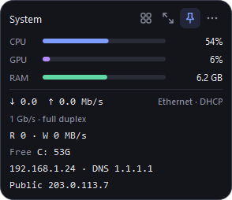
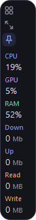
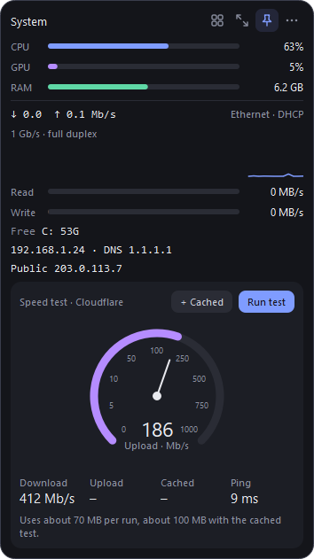
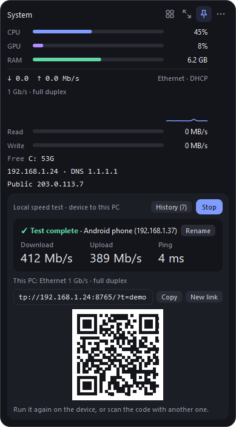

<h1 align="center">Desktop Stat Widget</h1>

<p align="center">
  A compact, always-on-top system and network monitor for Windows.<br>
  Live CPU, GPU, RAM, disk and network stats, plus a built-in network toolbox.
</p>

<p align="center">
  <a href="https://github.com/BlackGhost3/desktop-stat-widget/releases/latest"></a>
  
  
  <a href="LICENSE"></a>
</p>

<p align="center">
  
  &nbsp;
  
  &nbsp;
  
</p>
<p align="center">
  
</p>

<p align="center">
  <b><a href="https://github.com/BlackGhost3/desktop-stat-widget/releases/latest">Download DesktopStatWidget.exe</a></b>
  &nbsp;·&nbsp; no Python needed
</p>

---

## Highlights

- **Everything at a glance.** CPU, GPU, RAM, disk and network speed, IP addresses, link speed and VPN status in one small window that stays on top of your work.
- **A network toolbox built in.** Switch between DHCP and a static IP, change DNS in one click, ping, run an internet speed test, and measure the real speed between your phone and your PC.
- **Stays out of the way.** Three sizes, a vertical strip for screen edges, fading when your cursor is away, a global show/hide hotkey, and alerts that only speak up when something is wrong.

## Install

1. Download `DesktopStatWidget.exe` from the [latest release](https://github.com/BlackGhost3/desktop-stat-widget/releases/latest).
2. Run it. There is no installer, and it needs no Python.
3. To keep it running after a restart, right-click the widget and choose **Behavior, then Start with Windows**.

> Windows SmartScreen may warn about an unrecognized app because the exe isn't code-signed. Choose **More info**, then **Run anyway**. Each release lists the file's SHA-256 hash so you can verify the download.

The packaged app updates itself from new releases (right-click, then **Check for updates**).

**Requirements:** Windows 10 or 11 (developed and tested on Windows 10).

## Quick start

| To do this | Do this |
| --- | --- |
| Move the widget | Drag it anywhere. It snaps to screen edges and always stays fully on screen |
| Change size | Double-click it, or press the resize icon: full, compact, mini |
| Open a tool | Press the grid icon, then pick one panel |
| Keep it on top | Press the pin icon |
| Show or hide it | Press `Ctrl` + `Alt` + `W` from anywhere |
| See the heaviest apps | Click the CPU or RAM row |
| Copy an IP address | Click the local or public IP line |
| Open every setting | Right-click the widget, or press the dots icon |

## Features

### Monitoring
- CPU, RAM and GPU load. GPU works on any vendor through Windows GPU counters and can be switched off to save resources.
- Disk read and write speed, and free space per drive (turns red under 10%).
- Network download and upload speed with a live graph.
- Link speed: the negotiated Ethernet speed and duplex, shown in amber at 100 Mb/s or less, or the live Wi-Fi rate, band, channel and signal strength.
- Local and public IP addresses.
- A VPN badge when a tunnel such as WireGuard, OpenVPN or Tailscale is up.
- Battery level and power plan on laptops.
- A top-processes list with an **End** button for each app (system processes are protected).

### Network tools
- **Network settings:** switch the active adapter between DHCP and a static IP with address validation, pick a DNS preset (Cloudflare, Google, Auto or Custom), and save profiles such as Home and Office. Changes need your approval through a Windows admin prompt; the widget itself never runs elevated.
- **Ping:** any host, with a live latency graph, average, maximum and packet loss.
- **Connection history:** a graph of the last hour of pings to 1.1.1.1.
- **Internet speed test:** a Speedtest-style gauge for ping, download and upload against Cloudflare. An optional cached download fetches a CDN-cached file so you can compare it with the pure download.
- **Local speed test:** measure the speed between a phone or another PC and this PC. See [below](#local-speed-test).

### Alerts
Windows notifications from a tray icon. Each alert has a cooldown so it doesn't repeat:

- CPU or RAM above 90% for 30 seconds
- A drive under 10% free
- Connection lost, or heavy packet loss
- Battery at 15% or lower and not charging
- A saved network profile matches the network you just joined (you review and apply it yourself)

### Appearance and behavior
- Three sizes: full, compact and a single-line mini strip.
- The mini strip becomes a narrow **vertical column** when you drag it to the left or right screen edge, with the buttons stacked and optional thin bars for CPU, GPU and RAM.
- Dark, light or follow-Windows theme, with five accent colors.
- Adjustable opacity and optional fading when the cursor is away.
- Choose exactly which stats are shown, including in the mini strip.
- Global hotkey, start with Windows, and one-click updates from GitHub releases.

## A closer look

<p align="center">
  
  &nbsp;
  
  &nbsp;
  
</p>

## Local speed test

Measures the real speed between another device and your PC, for example to find weak Wi-Fi spots or check a cable. It tests your local network, not your internet connection.

<p align="center">
  
</p>

1. Open **Tools, then Local speed test** and press **Start**. The panel shows a link and a QR code.
2. Scan the code with a phone, or open the link in a browser on another computer on the same network.
3. The page measures ping, download and upload. The PC shows the same live gauge as the device.
4. Both screens end on a clear "Test complete" summary. Results are saved with the device name, IP address and time. Open **History** for up to 50 past results in their own window.

How it works and how it stays safe:

- Each direction is counted by the side that **receives** the data, so the number is the real throughput: the phone measures download, the PC measures upload, and both screens show the same figures.
- The server runs only while the panel is open, on a free port between 8765 and 8784.
- The link contains a random token, and only private (local network) addresses are accepted. Press **New link** to issue a fresh token and invalidate the old link and QR code.
- If a device can't connect, press **Allow in firewall**. It adds a rule for private networks only, after an admin prompt, and the button disappears once the rule exists.
- Android phones appear as "Android phone" because Chrome hides the model. Press **Rename** to give any device a name (remembered by IP address).

## Settings

Right-click the widget, or use the dots icon.

| Menu | Options |
| --- | --- |
| **Appearance** | Theme (auto, dark, light), accent color, opacity (100, 85, 70%), fade when the cursor is away (on by default), faded opacity (30, 50, 70%) |
| **Show** | CPU, RAM, network speed, disk speed, local IP and DNS, public IP, free disk space, GPU, bars in the vertical strip |
| **Behavior** | Start with Windows, alerts, connection monitor, the `Ctrl+Alt+W` hotkey |
| *Bottom of the menu* | Check for updates, current version, quit |

Settings and saved profiles live in `%APPDATA%\StatWidget\config.json`. Delete that file to reset everything.

## Privacy and network requests

Everything runs on your PC. These are the only outside connections the widget makes:

| Service | Used for | When |
| --- | --- | --- |
| `api.ipify.org` (fallback `ifconfig.me`) | Showing your public IP | At launch, then every 5 minutes |
| Ping to `1.1.1.1` | Connection history and alerts | Every 5 seconds. Can be turned off under Behavior |
| GitHub | Checking for and downloading updates | At launch and when you check |
| Cloudflare, and jsDelivr for the cached test | Internet speed test | Only when you press Run test |

There is no telemetry, and no account is needed.

## Build from source

```bash
pip install -r requirements.txt
python app.py
```

You can also double-click `run.bat`.

To build the exe:

```bash
pip install pyinstaller
build.bat
```

The result is `dist\DesktopStatWidget.exe`, a single file with no console window.

### Publishing a release

1. Bump `VERSION` in `updater.py` and push.
2. Run `build.bat`.
3. Create a release whose tag matches the new version and attach the exe:

   ```bash
   gh release create v1.3.2 dist\DesktopStatWidget.exe --title "v1.3.2" --notes "What changed"
   ```

The packaged exe downloads the new `DesktopStatWidget.exe` from the release, swaps itself in and restarts. A copy run from source downloads the release source and replaces its `.py`, `.txt`, `.bat` and `.md` files. A git checkout is never overwritten; the widget opens the release page instead.

### Project layout

| File | Purpose |
| --- | --- |
| `app.py` | The main window, menus, panels and event handling |
| `widgets.py` | Custom-drawn widgets: bars, graphs, the speed gauge, the vertical strip, the QR view |
| `theme.py` | Dark and light palettes, accent colors and the stylesheet |
| `sysinfo.py` | Readers for GPU load, adapter configuration, Wi-Fi details, public IP and ping |
| `features.py` | Internet speed test, top processes, connection monitor, alert rules, power plan |
| `localtest.py` | The local speed test server and its browser page |
| `history.py` | The local speed test history window |
| `winutil.py` | Startup entry, elevated commands and the settings file |
| `updater.py` | Checking for and installing updates |
| `hotkey.py` | The global show/hide hotkey |
| `tools/`, `assets/` | Icon generator and the generated icon |
| `build.bat`, `run.bat` | Build the exe, run from source |

## Troubleshooting

**Windows says the app is unrecognized, or antivirus flags it.** The exe isn't code-signed, and one-file apps made with PyInstaller are sometimes flagged. Check the SHA-256 hash on the release page, or build it yourself from source.

**A phone can't open the local speed test link.** Make sure both devices are on the same network, and not a guest network that isolates devices. Press **Allow in firewall** in the panel. The rule covers private networks only, so if Windows labels your network "Public", change it to "Private".

**Ethernet shows 100 Mb/s in amber on a gigabit port.** The cable, a connector or the port at the other end negotiated a slower speed. Try another cable or port.

**GPU shows "n/a".** The widget reads Windows GPU counters, which need a recent graphics driver. You can switch GPU off under **Show**.

**The hotkey does nothing.** Another app already uses `Ctrl+Alt+W`. Turn the hotkey off under **Behavior** and use the tray icon to show or hide the widget.

**An update installed but the app didn't restart.** Versions before 1.3.1 had a restart bug. Start the app again manually; updates from 1.3.1 onward restart on their own.

## License

Released under the [MIT License](LICENSE). The packaged exe bundles open-source components such as Qt, which keep
their own licenses; see [THIRD_PARTY_NOTICES.md](THIRD_PARTY_NOTICES.md).

## Limitations

- Windows only. Temperatures aren't shown because Windows has no built-in API for them.
- IP and DNS detection and changes use PowerShell and `netsh`, so some details may differ on non-English Windows.
- The screenshots use placeholder IP addresses.
