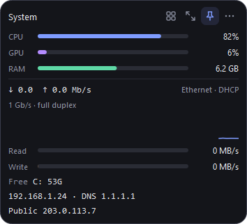
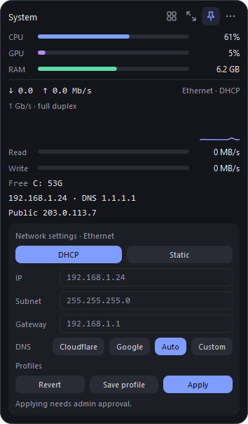
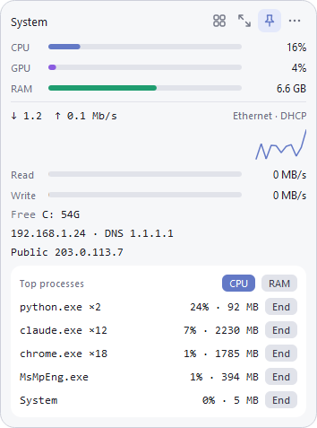

# Desktop stat widget

A small always-on-top Windows widget (Python + PySide6) showing live system stats, with network tools built in.

 

## Features

**Monitoring**
- CPU, GPU (any vendor, via Windows GPU counters) and RAM, with an optional GPU switch to save resources
- Disk read/write speed, free space per drive, network up/down speed with a Wi-Fi or Ethernet label
- Link speed: the negotiated Ethernet speed and duplex (amber at 100 Mb/s or less), or the live Wi-Fi rate, band, channel and signal strength
- Local and public IP (public IP is looked up through api.ipify.org every 5 minutes). Click either to copy it
- VPN badge when a VPN adapter (WireGuard, OpenVPN, Tailscale and similar) is up
- Battery and power plan on laptops
- Click CPU or RAM to see the top processes and end one

**Network tools** (grid icon)
- Network settings: switch the active adapter between DHCP and static IP, DNS presets (Cloudflare, Google, Auto, Custom), saved profiles
- Ping with a live latency graph, average, max and loss
- Connection history: a graph of the last hour of pings to 1.1.1.1
- Local speed test: the widget serves a test page on your LAN and shows a QR code and link. Open it on a phone or another PC to measure the real speed between that device and this PC (download, upload, ping). While a device is testing, the panel shows a live gauge of the speed the PC actually measures (download, then upload). The panel's History button opens past results (up to 50, with date, device and IP) in their own window so the main widget stays small. Results show the device and its IP address; Android phones appear as "Android phone" because Chrome hides the model, and you can rename any device (remembered by IP). "New link" issues a fresh token and invalidates the old link and QR code. The server only runs while the panel is open, needs the random token in the link, and only accepts private network addresses. If a device can't connect, press "Allow in firewall" in the panel
- Speed test against Cloudflare with a live Speedtest-style gauge. Pure download and upload use bytes no cache can answer. An optional cached download fetches a CDN-cached file (jsDelivr) so you can compare the two (about 70 MB per run, about 100 MB with the cached test)

**Alerts** (Windows notifications from a tray icon)
- CPU or RAM above 90% for 30 seconds, a drive under 10% free, connection lost, packet loss, low battery
- A saved network profile matches the network you're on (you review and apply it yourself)

**Appearance and behavior**
- Three sizes: full, compact, mini strip
- Dark, light or follow-Windows theme, five accent colors
- Always-on-top toggle, opacity, fade when the cursor is away, snap to screen edges
- Choose which stats are shown, including in the mini strip
- Drag the mini strip to the left or right screen edge and it turns into a narrow vertical column (with optional thin bars for CPU, GPU and RAM; toggle under Show); drag it away and it goes back to the horizontal strip
- Show or hide with Ctrl+Alt+W
- Start with Windows
- Update check and one-click install from GitHub releases

## Install

**Download:** get `DesktopStatWidget.exe` from the [latest release](https://github.com/BlackGhost3/desktop-stat-widget/releases/latest) and run it. No Python needed. Windows SmartScreen may warn about an unrecognized app because the exe isn't code-signed; choose "More info", then "Run anyway". The exe updates itself from new releases.

**From source:**

```bash
pip install -r requirements.txt
python app.py
```

Or double-click `run.bat`.

**Build the exe yourself:** `pip install pyinstaller`, then run `build.bat`. The result is `dist\DesktopStatWidget.exe`.

## Use

- Drag anywhere to move. Double-click, or press the resize icon, to cycle full, compact and mini.
- The pin icon toggles always on top. The grid icon opens the tools list, one panel at a time.
- Right-click, or use the dots icon, for Appearance, Show, Behavior, updates and quit.
- Applying IP or DNS changes asks for admin approval through a UAC prompt. The widget itself never runs elevated.

Settings and profiles are stored in `%APPDATA%\StatWidget\config.json`.

 

## Publishing an update

Bump `VERSION` in `updater.py`, push, run `build.bat`, then create a release whose tag is the new version and attach the exe:

```bash
gh release create v1.3.0 dist\DesktopStatWidget.exe --title "v1.3.0" --notes "What changed"
```

The widget checks on launch and from the menu. The packaged exe downloads the new `DesktopStatWidget.exe` from the release, swaps itself, and restarts. A copy run from source downloads the release source and replaces the `.py`, `.txt`, `.bat` and `.md` files. A git checkout is never overwritten; the widget opens the release page instead.

## Notes

- Windows 10/11 only. Temperatures aren't shown because Windows has no built-in API for them.
- IP/DNS detection and changes use PowerShell and `netsh`.
- Outside requests: api.ipify.org (public IP), ping to 1.1.1.1 (connection monitor, can be turned off), GitHub (updates), Cloudflare (speed test, only when you run it).
- The screenshots use placeholder IP addresses.
